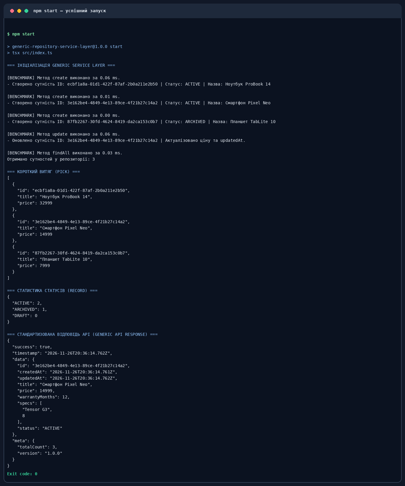
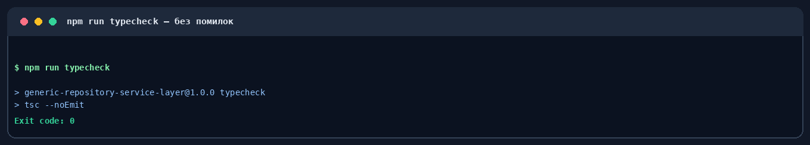

# Практична робота № 3

## Тема: Узагальнення, декоратори та утиліти типів TypeScript

Варіант виконання: 1 — «Електроніка та гаджети», сутність `GadgetEntity`
(`title`, `price`, `warrantyMonths`, `specs: [cpu: string, ramGb: number]`).

Умова завдання збережена у файлі [`task.md`](task.md).

---

## Опис проєкту

Модуль універсального сервісного шару та репозиторію в оперативній пам'яті
(In-Memory Generic Repository & Service Layer):

- generic-контракти `BaseEntity`, `ApiResponse<TData>`, `IRepository<T extends BaseEntity>`;
- `InMemoryRepository<T>` на основі `Map<string, T>`;
- DTO, згенеровані утилітарними типами: `CreateDto<T>`, `UpdateDto<T>`, `EntitySummary<T>`, `EntityAnalytics<T>`;
- декоратор методу `@LogExecutionTime()` і декоратор класу `@FrozenEntity()`;
- barrel files (`index.ts`) у кожному підкаталозі.

## Структура

```text
src/
  ├── types/
  │   ├── base-entity.ts            # BaseEntity
  │   ├── api-response.ts           # ApiResponse<TData>
  │   ├── entity-status.enum.ts     # enum EntityStatus
  │   ├── dto.types.ts              # CreateDto, UpdateDto, EntitySummary, EntityAnalytics
  │   ├── repository.interface.ts   # IRepository<T>
  │   ├── gadget.types.ts           # Gadget, GadgetSpecs
  │   └── index.ts                  # barrel
  ├── repositories/
  │   ├── in-memory.repository.ts   # InMemoryRepository<T>
  │   └── index.ts
  ├── decorators/
  │   ├── log-execution-time.decorator.ts
  │   ├── frozen-entity.decorator.ts
  │   └── index.ts
  ├── entities/
  │   ├── gadget.entity.ts          # @FrozenEntity() class GadgetEntity
  │   └── index.ts
  ├── services/
  │   ├── gadget.service.ts         # методи create/update/findAll з @LogExecutionTime()
  │   └── index.ts
  └── index.ts                      # інтеграційна демонстрація
```

## Запуск

```bash
npm install
npm start          # запуск через tsx
npm run typecheck  # перевірка типів без генерації файлів
npm run build      # компіляція в dist/
node dist/index.js # запуск скомпільованої версії
```

## Реалізація за рівнями

### Рівень 1

- `tsconfig.json`: `strict`, `noImplicitAny`, `experimentalDecorators`, `emitDecoratorMetadata`.
- `IRepository<T extends BaseEntity>` гарантує, що будь-яка сутність має `id`, тому репозиторій може безпечно шукати за ключем.
- `InMemoryRepository<T>` зберігає дані в `protected items = new Map<string, T>()`: пошук за `id` працює за O(1), а `create` не дозволяє дублювати ключ.

### Рівень 2

- `EntityStatus` — строковий `enum` (`ACTIVE`, `ARCHIVED`, `DRAFT`), поле `status` додане до `Gadget`.
- `CreateDto<T> = Omit<T, keyof BaseEntity>`: клієнт не передає `id`, `createdAt`, `updatedAt`.
- `UpdateDto<T> = Partial<CreateDto<T>>`: будь-яка підмножина змінюваних полів (PATCH).
- `EntitySummary<T> = Pick<T, "id" | "title" | "price">`.
- `EntityAnalytics<T> = Record<EntityStatus, number>`: компілятор вимагає лічильник для кожного статусу.
- `update(id, patch)` оновлює `updatedAt` і ігнорує системні поля навіть тоді, коли їх передали в обхід типів.

### Рівень 3

- `@LogExecutionTime()` підміняє `descriptor.value` обгорткою, яка вимірює час через `performance.now()`, викликає оригінал через `apply(this, args)` і повертає його результат.
- `@FrozenEntity()` викликає `Object.freeze()` на конструкторі та прототипі `GadgetEntity`. Спроба додати метод у прототип під час виконання завершується `TypeError`.
- `GadgetService` перетворює DTO на сутність і делегує роботу репозиторію через інтерфейс `IRepository<GadgetEntity>`.

## Скриншоти

Результати фактичного запуску команд:





---

## Відповіді на контрольні питання

**1. Що таке generics? Яку проблему вони вирішують порівняно з `any` / `unknown`?**
Generics — це параметри типу: функцію, клас чи інтерфейс пишуть один раз, а конкретний тип підставляють під час використання (`InMemoryRepository<GadgetEntity>`). З `any` компілятор перестає перевіряти типи, а з `unknown` перед кожним використанням потрібне звуження. Generic зберігає зв'язок між входом і виходом: `findById` повертає саме `GadgetEntity | null`, а не «щось».

**2. Як працює обмеження `extends`?**
`T extends BaseEntity` означає, що `T` має містити всі поля `BaseEntity`. Тому всередині класу можна звертатися до `item.id`, а спроба створити `InMemoryRepository<{ name: string }>` не скомпілюється.
```ts
function findEntityById<T extends { id: string }>(items: T[], id: string): T | undefined {
  return items.find((item) => item.id === id);
}
```

**3. Різниця між `Omit<T, K>` і `Pick<T, K>`?**
`Pick` залишає лише вказані ключі (прев'ю-моделі, списки: `EntitySummary`), а `Omit` прибирає вказані ключі й залишає решту (DTO створення без системних полів: `CreateDto`). Якщо треба кілька полів, зручніший `Pick`. Якщо треба «все, крім кількох», зручніший `Omit`.

**4. Для чого `Partial<T>` і чому він важливий для PATCH?**
`Partial<T>` робить усі поля необов'язковими. PATCH-запит передає лише поля, що змінюються, тому `UpdateDto<T> = Partial<CreateDto<T>>` дозволяє `{ price: 14999 }` і водночас забороняє невідомі поля та неправильні типи.

**5. Як працює `Record<K, V>`? Що можна передати як `K`?**
`Record<K, V>` описує об'єкт, де кожен ключ із `K` має значення типу `V`. `K` має бути підтипом `string | number | symbol`: літеральні об'єднання (`"low" | "high"`), строкові `enum`, `keyof T`. Якщо `K` — скінченне об'єднання, компілятор вимагає наявності всіх ключів, тому `EntityAnalytics` не можна залишити без `DRAFT`.

**6. Що таке декоратор? Які параметри потрібні в `tsconfig.json`?**
Декоратор — це функція, яка застосовується до класу, методу, властивості або параметра через синтаксис `@` і може додавати метадані або змінювати поведінку. Для класичних (експериментальних) декораторів потрібні `"experimentalDecorators": true`, а для генерації метаданих типів (їх використовує DI у NestJS) — `"emitDecoratorMetadata": true`.

**7. Що таке `PropertyDescriptor`? Як перехопити метод через `descriptor.value`?**
Це об'єкт опису властивості: `value`, `writable`, `enumerable`, `configurable` (або `get`/`set`). Для методу `descriptor.value` містить саму функцію. Її зберігають у змінну, записують у `descriptor.value` нову функцію-обгортку, яка виконує додаткову логіку й викликає оригінал через `original.apply(this, args)`, а потім повертають дескриптор.

**8. Що таке Barrel File і які переваги він дає?**
Barrel file — це `index.ts`, який реекспортує публічні елементи каталогу. Імпорти стають короткими (`from "./types/index.js"`), внутрішню структуру модуля можна змінювати без правок у клієнтському коді, а barrel явно показує публічний API модуля.
# WEB_T03
